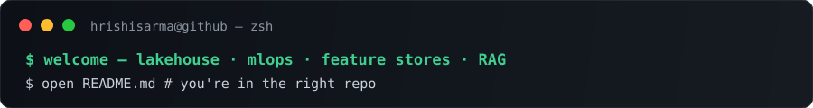

<div align="center">



<br/>


<br/>

[](https://github.com/hrishisarma)
[](https://github.com/hrishisarma)
[](https://github.com/goatapp)

</div>

---

### ```zsh``` session — `ssh github.com`

```bash
hrishisarma@github ~ % whoami
Hrishikesh Sarma — Staff Data Platform / Software Engineer
Round Rock, TX · Remote-friendly

hrishisarma@github ~ % cat about.txt
Staff engineer building lakehouse, streaming, and ML infrastructure at marketplace scale.
GOAT · Expedia · Comcast — Iceberg on S3, Kafka/Flink, Airflow tier-1 pipelines, data quality at 50+ flows.

hrishisarma@github ~ % ./skills --list
```

<div align="center">

[](https://skillicons.dev)

</div>

```bash
hrishisarma@github ~ % man experience
```

<table>
<tr>
<td width="50%" valign="top">

**GOAT Group** · Staff Software Engineer  
`Feb 2023 → Present` · Remote

```diff
+ S3 / Iceberg lakehouse — ~30% warehouse cost ↓, p95 &lt; 10s dashboards
+ 15+ ingestion connectors, ~2 TB/mo, contracts + replay
+ Kafka + Flink — 10K+ events/min, p99 &lt; 2s real-time KPIs
+ Airflow tier-1 — 99.9%+ through BFCM, snapshot recovery
+ Quality + observability — incident detect &lt; 30 min
```

</td>
<td width="50%" valign="top">

**Expedia Group** · Senior Software Engineer  
`Jan 2020 → Feb 2023` · Austin

```diff
+ Data / ML discovery platform — 40% faster asset discovery
+ Kafka Streams — sub-15-min freshness (hours → minutes)
+ Metadata, lineage, search at org scale
```

**Comcast** · Software Engineer  
`Earlier roles` · Distributed systems foundation

</td>
</tr>
</table>

```bash
hrishisarma@github ~ % npm run highlights
```

| metric | what shipped |
| :--- | :--- |
| `lakehouse` | Spark → Iceberg, Snowflake marts, compaction + time travel |
| `streaming` | Event-time windows, checkpoints, ops dashboards live during peak |
| `platform` | Shared ingestion standards · 4 partner teams · 20+ stakeholders |
| `ml_ops` | Feature store patterns · drift / freshness gates before prod |

```bash
hrishisarma@github ~ % git log --oneline --stat
```

<div align="center">


<br/>


</div>

```bash
hrishisarma@github ~ % ls ~/projects
```

<!--START_SECTION:repos-->
_Public repos will show here once you pin or push more work — try `gh repo list` locally._
<!--END_SECTION:repos-->

```bash
hrishisarma@github ~ % ./connect.sh
```

<div align="center">

[](mailto:dugisharma007@gmail.com)
[](https://linkedin.com/in/hrishisarma)
[](https://github.com/goatapp)

</div>

```bash
hrishisarma@github ~ % fortune
> "Backfills are just time travel with better audit trails."
hrishisarma@github ~ % █
```

<!-- snake eats contributions -->
