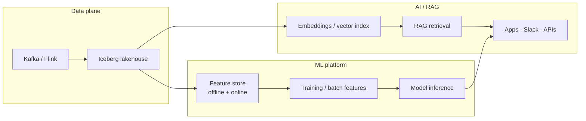

<div align="center">


<br/>


<br/>

[](https://github.com/hrishisarma)
[](https://github.com/hrishisarma)
[](https://github.com/goatapp)
[](https://hrishisarma.github.io)

</div>

---

### ```zsh``` session — `ssh github.com`

```bash
hrishisarma@github ~ % whoami
Hrishikesh Sarma — Staff Data Platform / Software Engineer
Round Rock, TX · Remote-friendly

hrishisarma@github ~ % cat about.txt
Staff engineer for lakehouse, streaming, and ML platform at marketplace scale.
Data planes (Iceberg, Kafka, Flink, Airflow) plus MLOps, feature stores, online inference,
and RAG-style retrieval for discovery, ranking, and internal AI tooling.

hrishisarma@github ~ % ./skills --list
```

<div align="center">

[](https://skillicons.dev)

</div>

```bash
hrishisarma@github ~ % cat ~/skills.txt
```

| area | stack |
| :--- | :--- |
| **Data platform** | Iceberg, Spark, Flink, Kafka, Airflow, Databricks, Delta Lake, Pinot |
| **Streaming** | Kafka Streams, Spark Streaming, Materialize |
| **Lakehouse / SQL** | S3, Snowflake, Redshift, Postgres, Parquet, Advanced SQL, Data Modeling |
| **Backends** | FastAPI, REST, Elasticsearch |
| **Cloud** | AWS, Kubernetes, Docker |
| **ML / AI / RAG** | Feature stores, online inference, PyTorch, embeddings, vector search, RAG, MLOps |
| **Languages** | Python, SQL, Java, Go, Shell |

```bash
hrishisarma@github ~ % man experience
```

<table>
<tr>
<td width="50%" valign="top">

**GOAT Group** · Staff Software Engineer  
`Feb 2023 → Present` · Remote

```diff
+ S3 / Iceberg lakehouse — ~30% warehouse cost ↓, p95 &lt; 10s dashboards
+ 15+ ingestion connectors, ~2 TB/mo, contracts + replay
+ Kafka + Flink — 10K+ events/min, p99 &lt; 2s real-time KPIs
+ Airflow tier-1 — 99.9%+ through BFCM, snapshot recovery
+ Quality + observability — incident detect &lt; 30 min
+ MLOps + feature store — offline/online features, drift + freshness gates
+ Inference paths for ranking/personalization — no stale features in prod
```

</td>
<td width="50%" valign="top">

**Expedia Group** · Senior Software Engineer  
`Jan 2020 → Feb 2023` · Austin

```diff
+ Data / ML discovery platform — 40% faster asset discovery
+ Kafka Streams — sub-15-min freshness (hours → minutes)
+ Metadata, lineage, search — foundation for ML + RAG-style discovery
```

**Comcast** · Software Engineer  
`Earlier roles` · Distributed systems foundation

</td>
</tr>
</table>

```bash
hrishisarma@github ~ % npm run highlights
```

| metric | what shipped |
| :--- | :--- |
| `lakehouse` | Spark → Iceberg, Snowflake marts, compaction + time travel |
| `streaming` | Event-time windows, checkpoints, ops dashboards live during peak |
| `platform` | Shared ingestion standards · 4 partner teams · 20+ stakeholders |
| `mlops` | Training pipelines, model registry patterns, deploy gates on drift |
| `feature_store` | Product / seller / buyer signals — offline training, online serving |
| `inference` | Low-latency serving APIs · feature freshness SLAs · FastAPI surfaces |
| `ai_rag` | Vector retrieval + catalog/lineage — search &amp; grounding for ML/LLM tools |

```bash
hrishisarma@github ~ % cat architecture/ml-platform.mmd
```



```bash
hrishisarma@github ~ % git log --oneline --stat
```

<div align="center">


<br/>


</div>

```bash
hrishisarma@github ~ % ls ~/projects
```

<!--START_SECTION:repos-->
_Public repos will show here once you pin or push more work — try `gh repo list` locally._
<!--END_SECTION:repos-->

```bash
hrishisarma@github ~ % open https://hrishisarma.github.io    # terminal résumé (Resume-dp.pdf)

hrishisarma@github ~ % ./connect.sh
```

<div align="center">

[](mailto:dugisharma007@gmail.com)
[](https://linkedin.com/in/hrishisarma)
[](https://github.com/goatapp)

</div>

```bash
hrishisarma@github ~ % fortune
> "Backfills are just time travel with better audit trails."
hrishisarma@github ~ % █
```

<!-- snake eats contributions -->
